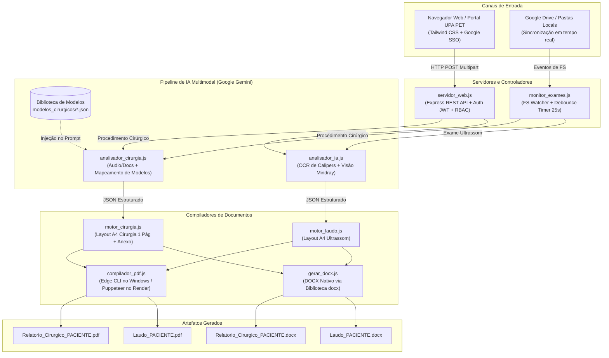
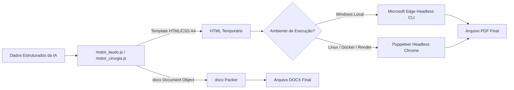
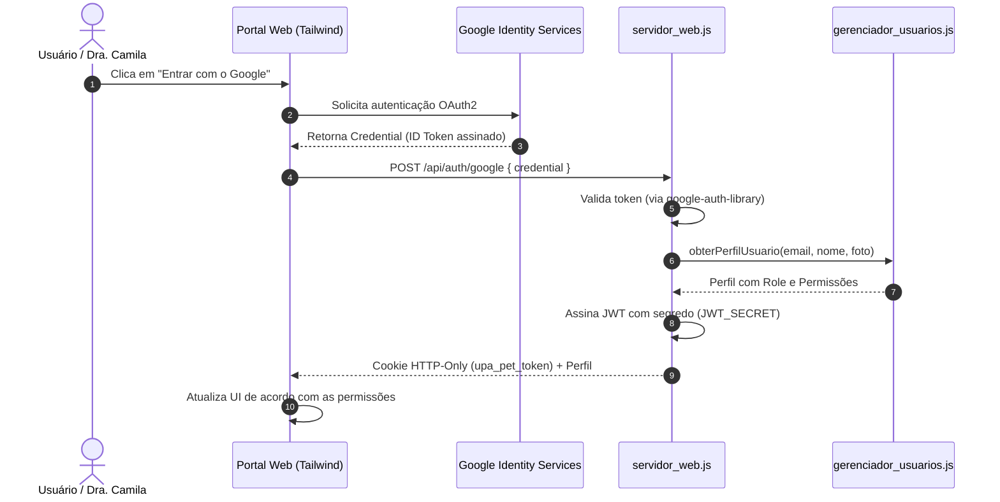

# 🏛️ Arquitetura e Engenharia do Sistema

Este documento descreve a arquitetura do **UPA PET - Central Inteligente de Laudos e Cirurgias**, detalhando componentes, fluxo de dados, pipelines de processamento e decisões de design.

---

## 1. Visão Geral da Arquitetura

O sistema é desenhado seguindo uma arquitetura modular orientada a serviços e pipelines assíncronos. Ele suporta duas interfaces de entrada complementares:
1. **Interface Web / REST API (`servidor_web.js`):** Utilizada no ambiente Cloud (hospedado no Render) por usuários via navegador, com autenticação Google SSO e controle de acesso RBAC.
2. **Daemon de Monitoramento Local (`monitor_exames.js`):** Executado como serviço em segundo plano no Windows, monitorando pastas sincronizadas do Google Drive para geração 100% autônoma e silenciosa.

Ambas as interfaces compartilham os mesmos motores de inteligência artificial (`analisador_*.js`) e os mesmos compiladores de documentos (`motor_*.js`, `gerar_docx.js`, `compilador_pdf.js`).

---

## 2. Componentes Principais

### 2.1. Núcleo Web (`servidor_web.js`)
- **Papel:** Ponto de entrada HTTP do sistema em produção.
- **Porta:** 3000 (ou atribuída dinamicamente via `process.env.PORT`).
- **Recursos Principais:**
  - Servidor estático para o painel web responsivo (Single-Page Dashboard).
  - Roteamento REST para submissão de ultrassons (`POST /api/ultrassom`) e cirurgias (`POST /api/cirurgia`).
  - Autenticação Google SSO (`POST /api/auth/google`) e verificação de sessões JWT seguras (`/api/auth/me`).
  - Endpoints de gestão de permissões de usuários (RBAC).
  - Endpoints CRUD da Biblioteca de Modelos Cirúrgicos (`/api/modelos-cirurgicos`).
  - Download seguro de relatórios gerados (`/downloads/:jobId/:filename`).
  - Healthcheck para monitoramento de disponibilidade (`/health`).

### 2.2. Daemon de Monitoramento (`monitor_exames.js`)
- **Papel:** Serviço autônomo para clínicas que salvam arquivos diretamente em pastas sincronizadas (como Google Drive para desktop).
- **Mecanismos de Resiliência:**
  - **Temporizador de Estabilização (Debounce):** Aguarda 25 segundos após a última alteração detectada na pasta para garantir que o upload do arquivo pesado (fotos em alta resolução ou áudios) tenha sido finalizado pelo Google Drive antes de processar.
  - **Gatilhos de Arquivo Vazio:**
    - `pronto.txt` / `ok.txt`: Dispara o processamento imediato sem esperar os 25 segundos.
    - `reprocessar.txt`: Força o reprocessamento de um exame já finalizado.
  - **Ignorância Ativa:** Não processa arquivos temporários do Word (`~$*.docx`), arquivos de sistema (`thumbs.db`) ou arquivos gerados pelo próprio robô (`Laudo_*.docx`, `Relatorio_*.docx`).
  - **Isolamento de Concorrência:** Cria cópias de trabalho em diretório temporário do sistema operacional (`os.tmpdir()`) para evitar travamento de arquivo (`EBUSY` / `lstat`) durante sincronizações na nuvem.

### 2.3. Motores de IA Multimodal

#### A. Analisador de Ultrassom (`analisador_ia.js`)
- **Entrada:** Array de caminhos de arquivos de imagem (capturas do Mindray).
- **Processamento:**
  - Converte as imagens para base64 e as envia para o Google Gemini Flash.
  - O prompt institucional instrui o modelo a:
    1. Identificar a sigla médica no cabeçalho ou tela do Mindray (`BEX`, `RE`, `RD`, `BACO`, `EST`, etc.).
    2. Fazer OCR e interpretação exata de calipers de medida (ex: `Dist 0.12 cm`, `Vol X.XX ml`, etc.).
    3. Aplicar os critérios diagnósticos da Dra. Camila Bastos e indicar `DIAG DIF.:` quando houver alterações patológicas.
    4. Mapear o índice de prioridade canônica de 1 a 20 para cada foto recebida.
- **Saída:** Objeto JSON contendo dados do paciente, array estruturado de órgãos (`laudo`) e a ordem canônica estrita das fotos (`classificacaoImagens`).
- **Resiliência:** Chaveia automaticamente entre modelos secundários caso haja sobrecarga na API (fallback automático).

#### B. Analisador Cirúrgico (`analisador_cirurgia.js`)
- **Entrada:** Arquivos de texto (`.docx`, `.pages`, `.txt`) ou áudios gravados (`.m4a`, `.mp3`, `.wav`, etc.) + fotos intraoperatórias opcionais.
- **Processamento:**
  - Extrai texto puro de arquivos complexos utilizando `mammoth` (para `.docx`) e `leitor_pages.js` (para `.pages`).
  - Lê dinamicamente os 14 modelos cadastrados em `modelos_cirurgicos/` através do `gerenciador_modelos.js`.
  - Constrói um super-prompt contendo os dados do procedimento e todas as técnicas oficiais da UPA PET.
  - A IA identifica o procedimento, normaliza termos, padroniza as frases de antissepsia, incisão, planos e suturas conforme o padrão da Dra. Camila.
- **Saída:** JSON padronizado com os dados do paciente, procedimento cirúrgico estruturado, diagnóstico pré-operatório, descrição técnica e evolução pós-operatória.

---

## 3. Pipeline de Compilação de Documentos

Uma das maiores inovações de engenharia deste projeto é a capacidade de gerar simultaneamente documentos em **dois formatos complementares**:
- **PDF de Alta Resolução:** Destinado ao tutor e prontuário definitivo, com tipografia exata, quebras de página protegidas e visual imutável.
- **Word (`.docx`):** Destinado à veterinária para eventuais edições pontuais, preservando tabelas, fontes e mosaicos fotográficos no padrão nativo do Office.

### 3.1. Compilação Híbrida de PDF (`compilador_pdf.js`)
Diferentes ambientes de produção possuem diferentes motores gráficos. Para garantir 100% de confiabilidade sem falhas:
1. **Windows (Ambiente Desktop):**
   - Detecta o executável nativo do **Microsoft Edge** (`msedge.exe`).
   - Invoca o Edge com flags headless (`--print-to-pdf`, `--run-all-compositor-stages-before-draw`, `--no-pdf-header-footer`).
   - Tempo de renderização: **< 1 segundo**, sem dependências externas e com fidelidade milimétrica.
2. **Linux / Render.com / Docker (Ambiente Nuvem):**
   - Utiliza **Puppeteer** com Chromium.
   - Inclui rotina de auto-recuperação: se o binário do Chrome não estiver no cache (`Could not find Chrome`), o script executa automaticamente `npx puppeteer browsers install chrome` em tempo de execução e retenta a compilação.
   - O `package.json` possui script `postinstall` configurado para pré-baixar o Chrome no build do Render.

### 3.2. Compilação Nativa de DOCX (`gerar_docx.js`)
- Constrói árvores de objetos da especificação OOXML utilizando a biblioteca `docx`.
- Cabeçalhos construídos com tabelas de bordas invisíveis para alinhamento perfeito do logotipo e colunas de dados do paciente.
- Rodapés institucionais fixos no documento inteiro com linha divisória cinza padronizada.
- Mosaicos de fotos embutidos em tabelas de 2 colunas com proporcionalidade restrita para evitar desconfigurações no Word/Pages.
- **Espaçamento Controlado:** Espaço pós-parágrafo configurado em twips (`spacing.after = 150` twips) para garantir respiro visual entre os órgãos sem gerar páginas em branco acidentais.

---

## 4. Segurança, Autenticação e RBAC

O sistema adota o modelo **Role-Based Access Control (RBAC)** gerenciado por `gerenciador_usuarios.js` e protegido no `servidor_web.js`:

### Papéis Disponíveis:
- **`admin`:** Controle total do sistema. Pode emitir laudos, relatórios cirúrgicos, criar/editar modelos e promover cargos de outros usuários.
- **`veterinario`:** Médico veterinário autorizado. Pode emitir laudos de ultrassom, emitir relatórios cirúrgicos e criar/editar modelos da biblioteca.
- **`assistente`:** Equipe de apoio/recepção. Pode consultar modelos e visualizar relatórios previamente gerados, sem permissão para emissão de novos documentos médicos.
- **`pendente`:** Novo usuário conectado pela primeira vez via Google SSO. Acesso bloqueado para emissão até que um administrador aprove seu cargo no painel.

---

## 5. Ciclo de Vida dos Arquivos e Armazenamento

- **Uploads Temporários:** Recebidos pelo middleware `multer` e salvos temporariamente em `os.tmpdir()/upa_pet_uploads`.
- **Arquivos Finais Gerados:** Armazenados temporariamente na pasta de trabalho `os.tmpdir()/upa_pet_outputs/{jobId}` e disponibilizados via endpoint de download `/downloads/:jobId/:filename`.
- **Limpeza de Memória/Disco:** Ao término de cada requisição (bloco `finally`), os arquivos temporários enviados no upload são excluídos imediatamente do disco para não consumir espaço desnecessário no servidor.
- **Modelos Cirúrgicos Institucionais:** Persistidos em arquivos JSON versionados no diretório `modelos_cirurgicos/*.json`.

---

*Para conhecer todas as regras médicas e parâmetros clínicos detalhados, consulte [BUSINESS_RULES.md](./BUSINESS_RULES.md).*
