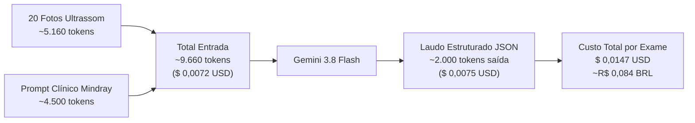

# Vetaro — Estudo Financeiro: Custos por Relatório e Margens de Lucro

> **Documento de Análise Econômico-Financeira e Unit Economics**  
> **Versão:** 1.0.0  
> **Cotação Base de Câmbio:** 1 USD = R$ 5,70 BRL  
> **Modelo Principal de IA:** Google Gemini 3.8 Flash (`gemini-3.8-flash`)  
> **Modelo Contingência:** Google Gemini 3.5 Flash-Lite (`gemini-3.5-flash-lite`)

---

## 1. Unit Economics: Custo por Relatório Emitido

O modelo financeiro do **Vetaro** é sustentado pela eficiência da geração multimodal do Google Gemini, que cobra por tokens e não por imagem fixa.

---

### 1.1. Detalhamento do Laudo de Ultrassonografia (20 Imagens)

| Componente | Tokens Estimados | Taxa da API (por 1M) | Custo em Dólar (USD) | Custo em Reais (BRL) |
| :--- | :---: | :---: | :---: | :---: |
| **Imagens de Ultrassom** (20 arquivos) | 5.160 tokens *(258/foto)* | $ 0,75 / 1M | $ 0,00387 | R$ 0,0220 |
| **Prompt de Sistema + JSON Schema** | 4.500 tokens | $ 0,75 / 1M | $ 0,00337 | R$ 0,0192 |
| **Total de Entrada (Input)** | **9.660 tokens** | — | **$ 0,00724** | **R$ 0,0412** |
| **Laudo Gerado (Output JSON Completo)** | 2.000 tokens | $ 3,75 / 1M | $ 0,00750 | R$ 0,0428 |
| **Custo Total de IA por Laudo** | **~11.660 tokens** | — | **$ 0,01474 USD** | **~R$ 0,0840 BRL** |

> [!NOTE]
> **Custo Médio de IA por Laudo de Ultrassom:** **R$ 0,084** (menos de 9 centavos de real).  
> Se o exame contiver 30 fotos: o custo sobe para apenas **R$ 0,105** (10,5 centavos).

---

### 1.2. Detalhamento do Relatório Cirúrgico

O relatório cirúrgico opera combinando o template institucional selecionado com as observações cirúrgicas digitadas pelo médico (técnica empregada, intercorrências, suturas, materiais):

| Componente | Tokens Estimados | Taxa da API (por 1M) | Custo em Dólar (USD) | Custo em Reais (BRL) |
| :--- | :---: | :---: | :---: | :---: |
| **Entrada** (Modelo + Anotações do Cirurgião) | 2.200 tokens | $ 0,75 / 1M | $ 0,00165 | R$ 0,0094 |
| **Saída** (Texto cirúrgico padronizado) | 1.100 tokens | $ 3,75 / 1M | $ 0,00412 | R$ 0,0235 |
| **Custo Total de IA por Relatório Cirúrgico** | **3.300 tokens** | — | **$ 0,00577 USD** | **~R$ 0,0329 BRL** |

> [!TIP]
> **Custo Médio por Relatório Cirúrgico:** **R$ 0,033** (apenas 3,3 centavos de real).

---

### 1.3. Comparativo de Custo: Gemini 3.8 Flash vs. Flash-Lite

| Modelo | Custo de Entrada / 1M | Custo de Saída / 1M | Custo por Laudo (20 fotos) | Qualidade Diagnóstica / Leitura Calipers |
| :--- | :---: | :---: | :---: | :---: |
| **Gemini 3.8 Flash** *(Oficial)* | $ 0,75 | $ 3,75 | **R$ 0,084** | **Excelente** (alta precisão em microdetalhes e medidas) |
| **Gemini 3.5 Flash-Lite** *(Fallback)* | $ 0,30 | $ 2,50 | **R$ 0,045** | **Básica** (risco de omissão de calipers e simplificação) |
| **Diferença Absoluta** | — | — | **R$ 0,039** | A economia de 4 centavos não justifica o risco clínico. |

---

## 2. Custos Variáveis Complementares (Por Transação)

Além da IA do Gemini, cada assinatura absorve os seguintes custos variáveis:
1. **Gateway de Pagamento (Asaas / Mercado Pago / Stripe):**
   - Pix: ~0,99% a 1,49% (ou R$ 0,99 fixo por cobrança).
   - Cartão de Crédito: ~2,99% a 3,49% + R$ 0,40 por transação.
   - *Estimativa adotada na modelagem:* **3,0% do valor da assinatura**.
2. **Armazenamento de Arquivos e Banco de Dados (Cloud VPS):**
   - Servidor VPS Docker (ex: Hetzner / DigitalOcean / AWS Lightsail): ~R$ 70,00 a R$ 120,00 / mês fixos.
   - Diluído por 100 clientes: **~R$ 0,90 por cliente/mês**.

---

## 3. Análise de Margens de Contribuição por Plano

Analisamos dois cenários de utilização para cada plano:
* **Cenário de Estresse (Worst-Case):** O cliente consome 100% da cota contratada no mês.
* **Cenário Realista (Real-Case):** O cliente consome em média 70% da cota (padrão SaaS com efeito *breakage*).

---

### 3.1. Plano Solo / Volante (Preço de Venda: R$ 79,00 / mês)

* **Cota:** 40 laudos de ultrassom / mês.

| Item | Cenário 100% da Cota (40 laudos) | Cenário Realista 70% (28 laudos) |
| :--- | :---: | :---: |
| **Receita Bruta** | **R$ 79,00** | **R$ 79,00** |
| (-) Custo de IA Gemini 3.8 Flash | - R$ 3,36 *(40 × R$ 0,084)* | - R$ 2,35 *(28 × R$ 0,084)* |
| (-) Taxa Gateway de Pagamento (3%) | - R$ 2,37 | - R$ 2,37 |
| (-) Infraestrutura Diluída | - R$ 0,90 | - R$ 0,90 |
| **Margem de Contribuição Bruta (R$)** | **R$ 72,37** | **R$ 73,38** |
| **Margem Bruta Percentual (%)** | **91,6%** | **92,9%** |

---

### 3.2. Plano Especialista Pro (Preço de Venda: R$ 149,00 / mês)

* **Cota:** 150 laudos de ultrassom + ~30 relatórios cirúrgicos estimados.

| Item | Cenário 100% da Cota (150 laudos + 30 cirurgias) | Cenário Realista 70% (105 laudos + 20 cirurgias) |
| :--- | :---: | :---: |
| **Receita Bruta** | **R$ 149,00** | **R$ 149,00** |
| (-) Custo de IA Ultrassom | - R$ 12,60 *(150 × R$ 0,084)* | - R$ 8,82 *(105 × R$ 0,084)* |
| (-) Custo de IA Cirurgias | - R$ 0,99 *(30 × R$ 0,033)* | - R$ 0,66 *(20 × R$ 0,033)* |
| (-) Taxa Gateway de Pagamento (3%) | - R$ 4,47 | - R$ 4,47 |
| (-) Infraestrutura Diluída | - R$ 1,20 | - R$ 1,20 |
| **Margem de Contribuição Bruta (R$)** | **R$ 129,74** | **R$ 133,85** |
| **Margem Bruta Percentual (%)** | **87,1%** | **89,8%** |

---

### 3.3. Plano Clínica & Hospital 24h (Preço de Venda: R$ 297,00 / mês)

* **Cota:** 500 laudos de ultrassom + ~80 relatórios cirúrgicos estimados.

| Item | Cenário 100% da Cota (500 laudos + 80 cirurgias) | Cenário Realista 70% (350 laudos + 55 cirurgias) |
| :--- | :---: | :---: |
| **Receita Bruta** | **R$ 297,00** | **R$ 297,00** |
| (-) Custo de IA Ultrassom | - R$ 42,00 *(500 × R$ 0,084)* | - R$ 29,40 *(350 × R$ 0,084)* |
| (-) Custo de IA Cirurgias | - R$ 2,64 *(80 × R$ 0,033)* | - R$ 1,81 *(55 × R$ 0,033)* |
| (-) Taxa Gateway de Pagamento (3%) | - R$ 8,91 | - R$ 8,91 |
| (-) Infraestrutura Diluída | - R$ 2,00 | - R$ 2,00 |
| **Margem de Contribuição Bruta (R$)** | **R$ 241,45** | **R$ 254,88** |
| **Margem Bruta Percentual (%)** | **81,3%** | **85,8%** |

---

## 4. Margem no Laudo Excedente (Pay-per-use)

Quando o veterinário atinge o limite do plano e continua gerando laudos:

| Plano | Preço Cobrado do Cliente | Custo Real de IA do Laudo | Lucro Bruto por Laudo Excedente | Margem Bruta |
| :--- | :---: | :---: | :---: | :---: |
| **Solo / Volante** | **R$ 2,00** | R$ 0,084 | **R$ 1,916** | **95,8%** |
| **Especialista Pro** | **R$ 1,50** | R$ 0,084 | **R$ 1,416** | **94,4%** |
| **Clínica & Hospital** | **R$ 1,00** | R$ 0,084 | **R$ 0,916** | **91,6%** |

> [!IMPORTANT]
> O consumo excedente é uma alavanca pura de rentabilidade: o cliente paga entre **R$ 1,00 e R$ 2,00** por um processo que custa menos de **R$ 0,09** para a sua infraestrutura.

---

## 5. Projeção de Faturamento e Lucro em Escala

Distribuição de base estimada: **50% Plano Solo**, **35% Plano Especialista Pro**, **15% Plano Clínica**.  
Ticket Médio Ponderado: $(0,50 \times 79) + (0,35 \times 149) + (0,15 \times 297) = \mathbf{R\$ 136,20 \text{ / cliente / mês}}$.

| Escala de Assinantes | Faturamento Mensal (MRR) | Custo Total de IA (Mês) | Custos de Gateway e Servidores | **Lucro Operacional Líquido Mensal** | Margem Líquida |
| :---: | :---: | :---: | :---: | :---: | :---: |
| **25 clientes** *(Validação)* | **R$ 3.405,00** | ~R$ 170,00 | ~R$ 190,00 | **R$ 3.045,00 / mês** | **89,4%** |
| **100 clientes** *(Tração)* | **R$ 13.620,00** | ~R$ 680,00 | ~R$ 560,00 | **R$ 12.380,00 / mês** | **90,9%** |
| **300 clientes** *(Crescimento)* | **R$ 40.860,00** | ~R$ 2.040,00 | ~R$ 1.550,00 | **R$ 37.270,00 / mês** | **91,2%** |
| **1.000 clientes** *(Escala Nacional)* | **R$ 136.200,00** | ~R$ 6.800,00 | ~R$ 4.900,00 | **R$ 124.500,00 / mês** | **91,4%** |

---

## 6. Análise de Sensibilidade e Tolerância Cambial

Como a API da Google é faturada em dólares americanos (USD), avaliamos o impacto de cenários de estresse no câmbio sobre a margem:

| Câmbio USD/BRL | Custo por Laudo (USD $0,0147) | Impacto no Plano Solo (40 laudos) | Margem Bruta no Plano Solo |
| :---: | :---: | :---: | :---: |
| **R$ 5,00** | R$ 0,073 | R$ 2,94 / mês | **93,2%** |
| **R$ 5,70 (Base)** | **R$ 0,084** | **R$ 3,36 / mês** | **91,6%** |
| **R$ 6,50 (Estresse)** | R$ 0,096 | R$ 3,82 / mês | **91,0%** |
| **R$ 7,50 (Crise Extrema)** | R$ 0,110 | R$ 4,41 / mês | **90,2%** |

> [!CAUTION]
> Mesmo que o dólar alcance **R$ 7,50**, a margem bruta de todos os planos permanece **superior a 90%**. O negócio possui imunidade cambial robusta devido ao consumo de tokens em fração microscópica de centavos.
