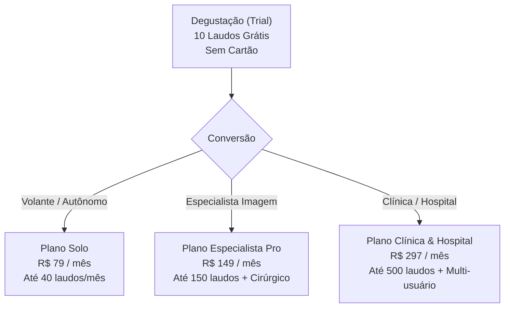

# Vetaro — Arquitetura de Planos e Assinaturas (SaaS)

> **Documento de Especificação de Negócio e Implementação Técnica**  
> **Versão:** 1.0.0  
> **Status:** Pronto para Implementação  
> **Branch de Referência:** `feat/postgres-multitenant`

---

## 1. Visão Geral da Estratégia de Precificação

O **Vetaro** posiciona-se no mercado veterinário não como um simples editor de texto com modelos estáticos, mas como uma **plataforma inteligente de produtividade clínica e diagnóstica**. O sistema realiza a pré-análise automatizada a partir das imagens do aparelho de ultrassom (Mindray e multimarcas), identifica órgãos, detecta medidas e gera laudos e relatórios formatados em Word (.docx) e PDF oficial em menos de 15 segundos.

Para capturar médicos veterinários autônomos, especialistas em diagnóstico por imagem e centros clínicos, a estrutura de planos adota:
1. **Preço de entrada altamente acessível** (abaixo dos concorrentes tradicionais que cobram R$ 140+ apenas por templates manuais).
2. **Margens brutas superiores a 85%** impulsionadas pelo custo ultraeficiente da API do Gemini 3.8 Flash.
3. **Plano de Onboarding "Degustação"** para eliminar qualquer atrito de ceticismo técnico.

---

## 2. Estrutura dos 3 Planos Oficiais



---

### Plano 0: Degustação Sem Risco (Onboarding Free Trial)
* **Preço:** **R$ 0,00** (Sem exigência de cartão de crédito no cadastro).
* **Cota:** **10 laudos de ultrassonografia completos**.
* **Objetivo:** Superar a barreira do ceticismo clínico. O médico sobe imagens reais do seu aparelho e constata a precisão da leitura de calipers, separação de paciente/tutor e diagramação em página única.
* **Custo operacional para o Vetaro:** ~R$ 0,85 no total por médico (Custo de Aquisição de Cliente extremamente baixo).

---

### Plano 1: Solo / Volante
*Ideal para veterinários autônomos, volantes ou plantonistas com demanda moderada de exames.*

* **Mensalidade:** **R$ 79,00 / mês** *(ou R$ 69,00 / mês faturado anualmente - R$ 828,00/ano)*
* **Cota Mensal:** Até **40 laudos de ultrassom** por ciclo.
* **Recursos Incluídos:**
  - 1 Acesso (Médico Titular com CRMV).
  - Upload de até 25 fotos por exame de ultrassom.
  - Sanitização automática de dados do paciente e tutor (padrão Mindray).
  - Emissão nos formatos oficiais `.docx` (editável) e `.pdf` (pronto para envio).
  - Logomarca da clínica/marca pessoal e assinatura digitalizada no cabeçalho.
  - Histórico de exames emitidos dos últimos 6 meses.
* **Excedente (Pay-per-use):** **R$ 2,00 por laudo adicional** (caso ultrapasse a cota de 40).
* **Gatilho de Venda:** *"Custa menos da metade do valor de um único exame de ultrassom que você realiza no mês."*

---

### Plano 2: Especialista Pro *(Plano Recomendado / Carro-Chefe)*
*Ideal para ultrassonografistas dedicados, radiologistas e veterinários com rotina intensa.*

* **Mensalidade:** **R$ 149,00 / mês** *(ou R$ 129,00 / mês faturado anualmente - R$ 1.548,00/ano)*
* **Cota Mensal:** Até **150 laudos de ultrassom** por ciclo + **Relatórios Cirúrgicos Ilimitados**.
* **Recursos Incluídos:**
  - 1 Acesso Titular + 1 Acesso Assistente/Secretária (para digitação ou pré-cadastro).
  - Upload de até 35 fotos por exame de ultrassom.
  - Módulo completo de **Relatórios Cirúrgicos** (modelos institucionais e personalizados).
  - Customização avançada de layout (tipografia, paletas de cores institucionais, margens).
  - Histórico e armazenamento em nuvem permanente de todos os exames emitidos.
  - Suporte prioritário via WhatsApp.
* **Excedente (Pay-per-use):** **R$ 1,50 por laudo adicional**.
* **Gatilho de Venda:** *"Economize mais de 25 horas de digitação por mês e entregue o laudo no WhatsApp antes de o paciente sair da clínica."*

---

### Plano 3: Clínica & Hospital 24h
*Ideal para clínicas veterinárias estruturadas, hospitais 24h e centros de diagnóstico por imagem.*

* **Mensalidade:** **R$ 297,00 / mês** *(ou R$ 259,00 / mês faturado anualmente - R$ 3.108,00/ano)*
* **Cota Mensal:** Até **500 laudos de ultrassom** por ciclo + **Relatórios Cirúrgicos Ilimitados**.
* **Recursos Incluídos:**
  - Até **5 contas de veterinários** com controle de permissões por perfil (RBAC: Admin, Ultrassonografista, Cirurgião).
  - Emissão com CRMV e assinatura individual de cada médico sob a identidade visual da clínica.
  - Painel analítico de produtividade (volume de laudos emitidos por profissional).
  - Upload prioritário de até 50 fotos por exame.
  - Treinamento inicial (onboarding) para a equipe técnica da clínica.
* **Excedente (Pay-per-use):** **R$ 1,00 por laudo adicional**.
* **Gatilho de Venda:** *"Padronize 100% dos laudos da sua equipe médica com um sistema centralizado e controle de acessos."*

---

## 3. Matriz Comparativa de Recursos

| Recurso | Degustação (Free) | Solo / Volante | Especialista Pro | Clínica & Hospital 24h |
| :--- | :---: | :---: | :---: | :---: |
| **Mensalidade** | R$ 0,00 | **R$ 79,00** | **R$ 149,00** | **R$ 297,00** |
| **Cota de Laudos/mês** | 10 (total) | 40 / mês | 150 / mês | 500 / mês |
| **Relatórios Cirúrgicos** | 2 testes | — | **Ilimitado** | **Ilimitado** |
| **Usuários Simultâneos** | 1 | 1 | 2 (Titular + Auxiliar) | **Até 5 veterinários** |
| **Assinatura e Logo Próprios** | Sim | Sim | Sim | **Sim (Multimédico)** |
| **Formatos de Saída** | Word e PDF | Word e PDF | Word e PDF | Word e PDF |
| **Histórico em Nuvem** | 15 dias | 6 meses | **Permanente** | **Permanente** |
| **Valor do Laudo Excedente** | Bloqueia | R$ 2,00 | R$ 1,50 | R$ 1,00 |
| **Suporte Técnico** | E-mail | Padrão (E-mail) | WhatsApp Prioritário | WhatsApp Dedicado |

---

## 4. Guia de Implementação Técnica no Código

### 4.1. Extensão do Schema Prisma (`prisma/schema.prisma`)

Para suportar o controle multitenant e o consumo de planos, a entidade `User` e a nova entidade `Subscription` devem ser integradas:

```prisma
enum PlanTier {
  TRIAL
  SOLO
  PRO
  CLINICA
}

enum SubscriptionStatus {
  ACTIVE
  PAST_DUE
  CANCELED
  TRIALING
}

model Subscription {
  id                   String             @id @default(cuid())
  userId               String             @unique
  user                 User               @relation(fields: [userId], references: [id], onDelete: Cascade)
  plan                 PlanTier           @default(TRIAL)
  status               SubscriptionStatus @default(TRIALING)
  quotaLimit           Int                @default(10) // 10 para trial, 40 solo, 150 pro, 500 clinica
  quotaUsedCurrentMonth Int               @default(0)
  cycleStartDate       DateTime           @default(now())
  cycleEndDate         DateTime
  externalCustomerId   String?            // ID do cliente no gateway (Asaas / Stripe)
  externalSubscriptionId String?          // ID da assinatura recorrente
  createdAt            DateTime           @default(now())
  updatedAt            DateTime           @updatedAt

  @@index([userId, status])
}
```

### 4.2. Middleware de Verificação de Cota (`middlewares/verificarCota.js`)

Antes de disparar a análise do Gemini 3.8 Flash, o backend deve validar se o usuário ainda possui cota disponível no ciclo:

```javascript
async function verificarCotaDisponivel(req, res, next) {
  const userId = req.user?.id;
  if (!userId) return res.status(401).json({ erro: 'Não autenticado' });

  const sub = await prisma.subscription.findUnique({ where: { userId } });
  if (!sub || sub.status !== 'ACTIVE' && sub.status !== 'TRIALING') {
    return res.status(403).json({
      erro: 'Assinatura inativa ou expirada. Atualize seu plano para continuar emitindo laudos.'
    });
  }

  // Verificar renovação do ciclo mensal
  const agora = new Date();
  if (agora > sub.cycleEndDate) {
    // Reset automático do ciclo mensal
    await prisma.subscription.update({
      where: { userId },
      data: {
        quotaUsedCurrentMonth: 0,
        cycleStartDate: agora,
        cycleEndDate: new Date(agora.getFullYear(), agora.getMonth() + 1, agora.getDate())
      }
    });
    sub.quotaUsedCurrentMonth = 0;
  }

  if (sub.quotaUsedCurrentMonth >= sub.quotaLimit) {
    return res.status(402).json({
      erro: 'Limite mensal de laudos atingido.',
      detalhes: {
        usado: sub.quotaUsedCurrentMonth,
        limite: sub.quotaLimit,
        excedentePermitido: true
      }
    });
  }

  next();
}
```

### 4.3. Interface do Usuário (`frontend/src/pages/SettingsPage.jsx`)

Na aba **"Plano e Assinatura"** do frontend, exibir:
1. **Card de Consumo em Tempo Real:** Barra de progresso com `laudosUsados / cotaTotal` (ex: "32 de 40 laudos utilizados este mês").
2. **Dias restantes para renovação** do ciclo.
3. **Botão de Upgrade:** Transição imediata de `Solo` para `Pro` ou `Clínica`.
4. **Modal de Contratação de Laudos Excedentes:** Compra rápida de pacotes avulsos (+20 laudos) via Pix instantâneo.
